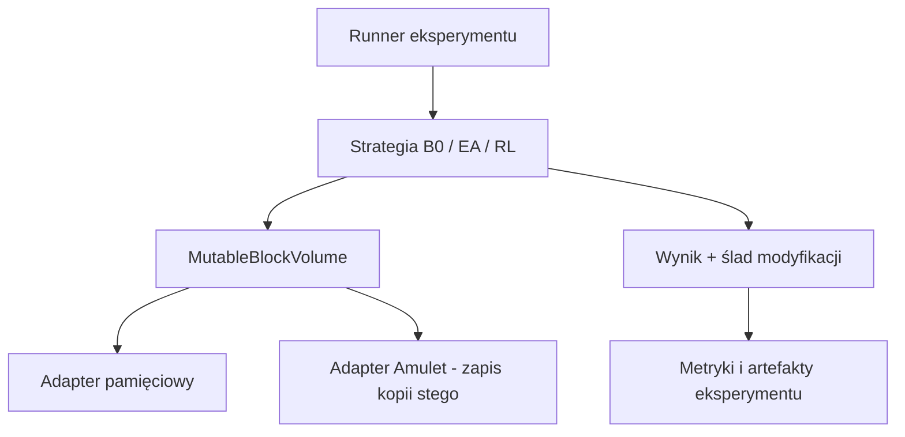
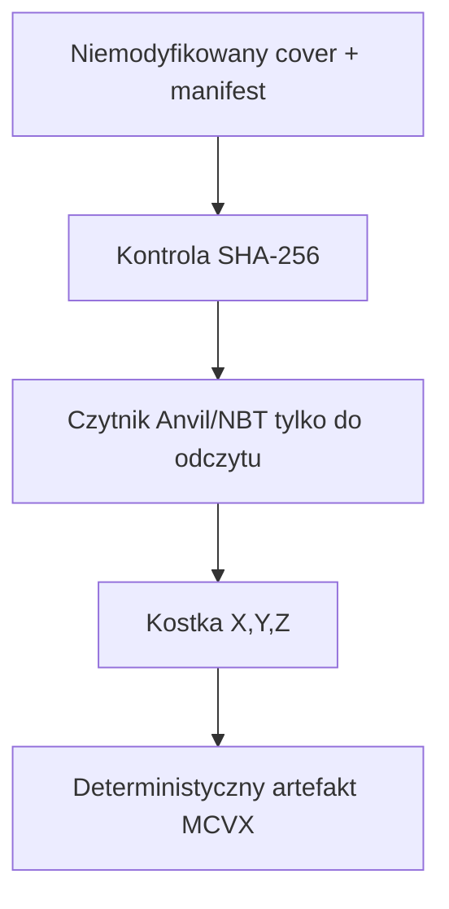
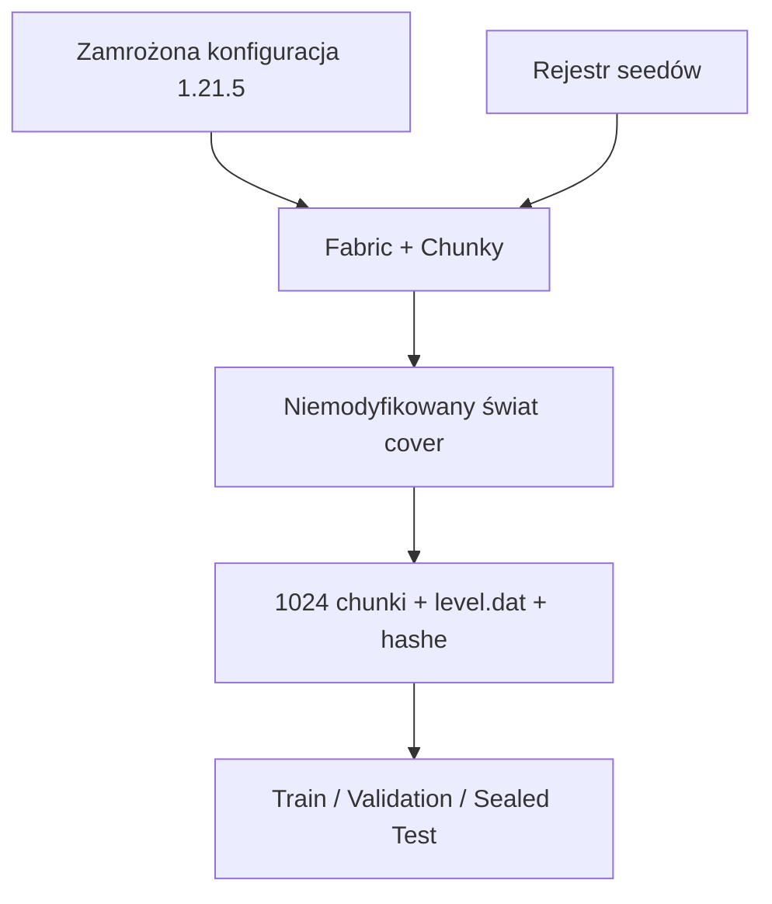

# Architektura po etapie 0

## Zasady graniczne

1. Strategia nie importuje Amuleta, Gymnasium ani bibliotek kryptograficznych.
2. Nośnik udostępnia tylko granice oraz operacje `get_block` i `set_block`.
3. Nawigacja i selekcja kandydatów są wspólne dla osadzania i ekstrakcji.
4. Każde osadzanie zwraca pełny ślad modyfikacji do późniejszej analizy.
5. Kryptografia i ECC tworzą payload, ale nie wybierają wokseli.
6. Detektor Eve ocenia wynik, ale nie jest częścią implementacji B0.

Taki podział pozwala uruchamiać identyczną strategię na zapisie Minecraft,
macierzy wokselowej, środowisku RL i podczas optymalizacji ewolucyjnej.

## Kanoniczny odczyt wokseli od wersji 0.1.0

Czytnik w `mcstego.voxels` nie zależy od Amuleta i nie ma żadnej ścieżki zapisu do świata. 
Amulet pozostaje osobnym adapterem potrzebnym później do tworzenia kopii `stego`; nigdy nie pracuje w trybie zapisu na coverze.

Identyfikatory bloków zapisane w MCVX są lokalne dla jednej kostki. 
Ich znaczenie określa dołączona paleta, dlatego przed łączeniem wielu kostek w batch należy wykonać jawne mapowanie do zamrożonego słownika eksperymentu.

## Powtarzalne nośniki od wersji 0.1.0

Podział następuje na poziomie całych światów. Wszystkie chunki jednego seedu należą do dokładnie jednego splitu. 
Światy `cover` po wygenerowaniu są niemutowalne; osadzanie zawsze pracuje na ich kopiach.
